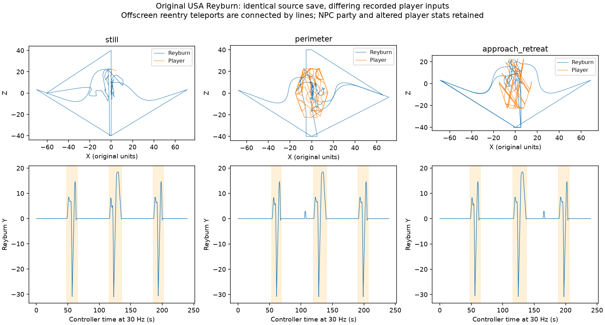

# Reyburn original-game parity audit (2026-10-12)

This audit uses the USA retail ROM, actual melonDS execution, RAM breakpoints, and
original archive tables. It is not a claim that the complete Godot encounter is
already 1:1. The consumer is `psz-godot:feature/reyburn-original-parity`.

## Reproduction and limits

`python3 tools/reyburn_parity.py --check` rebuilds the inventory from the ROM and
checks the retained compressed traces in `data/traces/reyburn_parity/`. Each trace
has a metadata file with source save hash, input schedule, hooks, requested and
captured updates, and every tracer memory write. `tools/boss-live-run.sh` starts
an owned emulator and `tools/boss_trace.py --reyburn-details` captures controller,
path, projectile, effect and attack state. `--input-script` applies XTEST keys at
controller breakpoints; player-position samples independently confirm movement.
Input ticks are controller updates, not wall-clock seconds during debugging.

All runs start from the same mid-fight Normal save with NPC companions. Its player
already has 9999 HP and inflated PP; turning emulator cheats off does not undo save
state edits. The melee finish kills in one hit and is evidence of death dispatch,
not ordinary player damage balance. Repeated directional input is not perfect
fixed-radius circling: camera-relative controls, collision and NPC targeting all
matter. Standing still means no player input, not that the boss has only one target.
No fresh entrance, clean-stat solo, other difficulty or multiplayer run is claimed.

## Original test matrix

| Run | Updates | Input/intervention | Purpose |
|---|---:|---|---|
| still | 7,200 | No input | Baseline normal flights and attacks |
| perimeter | 7,200 | Left/up/right/down, 180-update legs | Repeated movement and target-relative choices |
| approach_retreat | 7,200 | Up/down, 300-update legs | Closing and retreating |
| still_long | 18,000 | No input | Natural enhanced transition and spin |
| flight_closeup | 4,800 | No input; timed screenshots | Original sampled spline tables and movement kernel |
| still_extended | 24,000 | No input | More flight paths; NPC damage stalls at 110 HP |
| melee_finish | 69 | Up, then actual attack input; stop at death dispatch | Action 9 reached by player input |
| horn_seeded | 6,000 | One explicit part-budget write, 660 → 1 | Real head hit exhausts budget and disables bite |

Total: **74,469 original updates**, including 68,469 without tracer RAM writes and
6,000 in the explicitly seeded branch experiment. Roughly 41.4 minutes at unit
30 Hz; breakpoint overhead makes wall-clock execution longer. All 24 action IDs
except entrance alias 0 were observed. All 16 request sequences are exercised by
the Godot arena probe; original sequence coverage is recorded separately in JSON.

## How often he flies, and what movement changes

The flight countdown starts at 1500 Q12-effective updates and resets to 1500 when
the flight **finishes**, not when it starts. At unit rate this is about 50 seconds
of grounded time plus the current attack/transition. Existing state completion
and enhanced time scaling can change observed start intervals. In the retained
long run, enhanced B4 decrements by **4710 raw Q12 units** per controller call
(about 1.15 nominal updates), observed on 4,443 non-reset transitions. Running around
changes facing, positions and the chosen attack; it does not replace that timer
with a simple probability on each animation.

First three flights, start → completion (original controller ticks):

| Input | Flight 1 (claw) | Flight 2 (center breath) | Flight 3 (claw) |
|---|---|---|---|
| Still | 1443 → 1960 | 3462 → 4068 | 5570 → 6063 |
| Directional movement | 1603 → 2061 | 3589 → 4217 | 5719 → 6205 |
| Approach/retreat | 1443 → 1928 | 3493 → 4130 | 5665 → 6175 |

These are measurements from one initial save, not universal takeoff timestamps.
The starting save already has part of its initial timer elapsed. Ground selection
uses distance, bearing, tail/head damage, floor availability and cooldowns. Standing
behind him is therefore not equivalent to standing in front; movement traces
retain the actual player and boss coordinates rather than assigning behavior from
input labels alone. NPC target selection prevents attributing every turn to Aiya.

For the equal-length 7,200-update runs, these are **animation starts**, not
independent attack-selection probabilities (restarts and multi-stage attacks can
increment them). The same initial save produces visibly different grounded
behavior when input changes:

| Observed action starts | Still | Directional movement | Approach/retreat |
|---|---:|---:|---:|
| Normal bite (16) | 18 | 14 | 10 |
| Advancing bite (17) | 4 | 9 | 4 |
| Ground breath start (10) | 7 | 6 | 7 |
| Wing attack (13) | 3 | 3 | 4 |
| Tail right (14) | 2 | 3 | 1 |
| Tail left (15) | 5 | 2 | 5 |
| Run clip (6) | 6 | 2 | 3 |
| Boss HP at capture end | 841 | 902 | 975 |

NPCs did the damage in these three runs. Even the no-input player moves under
combat displacement: X ranges about -1.08 to 4.84 and Z 13.09 to 22.62. Thus the
still case cannot stand in for controlled front/flank/rear experiments. The
original spatial selector includes a normal bite band 8–10 with a narrow facing
cone, advancing bite 12.5–17.5 with another narrow cone, and cooled-down breath
15–50 within 45 degrees. Damage counters and pending states can take precedence.

## Three distinct aerial sequences

The selector at ov20 `02199C98` alternates a center-breath flight with an attack
flight. With controller C8 clear it selects 11. With C8 set it selects **9 normal
claw**, or **10 enhanced spin**. Completing 11 sets C8; completing 9/10 clears it.
The previous Godot code inverted the normal/enhanced branch and overrode the three
sequences with a shared multiple-fireball pass routine.

All three start with action 7 (`flst` → `fly`). Notification 2 releases a short
vertical lift. A five-control-point path then exits the **left or right side**:
current; current+(±5,+5,0); current+(±10,+5,0); (±20,7,0); (±60,7,0).
The side follows current X. He changes to `gld2claw` → `claw`, continues outward
and drops below Y=-30. The next state repositions him offscreen at **an end**,
(0,-30,±40), facing inward, then rises with action 18 at 1.25 animation rate to
Y>=12.5. It is not a continuous visible orbit over the player.

* **9, normal claw:** descends along a curve toward end-side Z±22/±20, steers
  through the arena, uses 30/10-unit forward floor tests, decelerates, leaves a
  lingering claw/ground-damage object, and recovers. **No projectile launch.**
* **10, enhanced spin:** one initial path plus five further passes. Speed and
  attraction multiply by 4506/4096 each pass. Target-relative bends and alternating
  lateral steering change the route. `rdg` is followed by `tr2gl` recovery.
  **No center-breath projectile.**
* **11, center breath:** action 19, one shot from jaw joint 11 toward the **arena
  center**, not the player. It waits for projectile/impact expiry, starts a
  separately tracking ground-fire trail, waits in flight and returns to land.

The request chooses one of two reentry ends and a landing point with X in [-6,6)
and Z in [-17,17). Original paths use Q12 natural cubic interpolation sampled at
16 points, not Catmull–Rom. The retained set provides **749 exact sampled points**.
The independent follower check covers **414 one-update transitions**: all are
within one raw Q12 unit (1/4096 world unit). These checks do not by themselves
prove whole-flight integration, facing, root motion, collision or damage parity.

## Ground attacks and break state

Breath actions are 10 → 11 → 12. The held action 11 lasts **one update for type 0,
two for type 1** in these original captures, not the old 15/45-update delay.
Notification dispatch and projectile creation are separate updates. Type 0 uses
three shots at 0 and ±0xE38 turn units; type 1 uses one stronger homing shot.
Head/bite actions 16/17 and wing/tail/turn/run/jump/reaction actions remain distinct.
The original bite stage timing is retained; its movement multiplier is not a
license to speed up the animation.

Horn budget is 660 from base stat 3300, despite this encounter's scaled max HP1650.
In the seeded experiment an actual NPC hit at tick495 has delta -4 and part byte1,
changes budget 1 → -3 and sets flag0x80. Sequence12 follows, action3 plays, and no
further bite16/17 occurs. This proves the branch without pretending to have
naturally accumulated 660 head-only damage. Original model channel1 is attached to
channel0's raw joint12 (`atama`) and is hidden on break. Godot now attaches the
existing horn part there and sets its controller's bite-blocked flag on break.

## Runtime objects and resource bindings

The boss is not just one mesh plus an animation player:

| Object | Original behavior | Godot status on this branch |
|---|---|---|
| Body and separate horn | Body rig, channel1 head attachment; hide on break | Body clips and separate horn attached |
| Six projectile slots | Type0 speed2458/4096, type1 1.5, air1.25 per update; homing; low-height damage; impact expiry | Dedicated controller-stepped pool; primitive visuals/shared damage |
| Six ground-fire slots | Attack after age2 through15; effect expiry around31/32 | Separate delayed pool |
| Ground-fire tracker | Emits every8 unit updates, turns0x222, moves0.5, ends at150 updates or edge | Implemented; floor and random sampling adapters |
| Claw ground-damage object | Rises, remains attacking about300 updates, retracts | Lifetime ported; kind1 rectangle/primitive visual approximate |
| Body contact/animation attacks | Separate attack records, attachment transforms and hit memory | Shared Godot damage/shape adapter; not bit-exact |
| Effect attachments | Thirteen resource bindings listed below | Complete inventory; original effect rendering not complete |

| Binding | Original resources |
|---|---|
| 0 | `ef_e_m_br.nsbmd`, `ef_e_m_br.nsbtx`, `ef_e_m_br.nsbca` |
| 1 | `ef_e_m_mbr.nsbmd`, `ef_e_m_br.nsbtx`, `ef_e_m_mbr.nsbca` |
| 2 | `ef_e_m_kaze.nsbmd`, `ef_e_m_kaze.nsbca`, `ef_e_m_kaze.nsbma` |
| 3 | `ef_e_m_cry.nsbmd`, `ef_e_m_cry.nsbca`, `ef_e_m_cry.nsbma` |
| 4 | `ef_e_m_spin.nsbmd`, `ef_e_m_taill.nsbtx`, `ef_e_m_spin.nsbca` |
| 5 | `ef_e_m_br_s.nsbmd`, `ef_e_m_br_s.nsbtx`, `ef_e_m_br_s.nsbca`, `ef_e_m_br_s.nsbma` |
| 6 | `ff_e_m_fire.nsbmd`, `ef_e_m_br.nsbtx`, `ff_e_m_fire.nsbca`, `ff_e_m_fire.nsbma` |
| 7 | `ef_en_m_dfog.nsbmd`, `ef_en_m_dfog.nsbca`, `ef_en_m_dfog.nsbma` |
| 8 | `ef_e_m_brhit.nsbmd`, `ef_e_m_brhit.nsbca`, `ef_e_m_brhit.nsbma`, `ef_e_m_brhit.nsbta` |
| 9 | `o0b_dradmg.nsbmd`, `o0b_dradmg.nsbta` |
| 10 | `ef_e_m_taill.nsbmd`, `ef_e_m_taill.nsbtx`, `ef_e_m_taill.nsbca`, `ef_e_m_taill.nsbma` |
| 11 | `ef_e_m_lfire.nsbmd`, `ef_e_m_br.nsbtx`, `ef_e_m_lfire.nsbca`, `ef_e_m_lfire.nsbma` |
| 12 | `ef_e_m_fogc.nsbmd`, `ef_e_m_fogc.nsbca`, `ef_e_m_fogc.nsbma` |

Names are resource bindings, not proof that each effect is spawned on every action.
The trace separately records effect-spawn calls and attack records.

## Authored arena objects

The arena set files are separate from the boss-owned effect and projectile pools.
Re-parsing `build/fs/set/01/z/na1/s01z_na1_*.rel` with the existing
`setobj.all_records()` and `objplace.rooms()` resolves a return-warp model
(`o0s_warps`, factory7/variant1), a treasure chest (`o0c_trebox`, factory10/variant0),
and a modelless player-entry record (factory1) in **d, s, f1, f2, f3 and f4**.
The first free-field set also has factory22/variant0 at (-13.283,0,0.790).
The registry resolver emits no model, but the existing `sys.object-class-table`
proof identifies type0x2016/class0x15 as the quest marker named **???**: constructor
`0209F60C` spawns effect48, `ef_com_quest`. It is an effect-backed quest object,
not a missing boss mesh.

| Set | Authored records | Return warp X/Z | Chest X/Z | Player entry X/Z |
|---|---:|---|---|---|
| d | 3 | 0.627 / 5.757 | 0.551 / -7.496 | 0.323 / 15.753 |
| s | 3 | 0.548 / 6.183 | 0.551 / -7.496 | 0.323 / 15.753 |
| f1 | 4 | 0.450 / -0.250 | -7.844 / 0.269 | 0.323 / 18.054 |
| f2 | 3 | 0.345 / -0.206 | 0.551 / -7.496 | 0.323 / 18.054 |
| f3 | 3 | 0.530 / 4.743 | 0.551 / -7.496 | 0.323 / 18.054 |
| f4 | 3 | 0.345 / 12.304 | 0.551 / -7.496 | 0.323 / 18.054 |

These are authored coordinates, not proof of when a visible object appears.
The capture set does not establish all quest-family selection or reward/warp
activation events. Godot's debug fight currently retains its return-warp adapter;
full reward-object and quest-event parity remains open. The exact interaction
script and activation conditions for this f1 quest marker were not exercised.

## Animation accounting

All **26 body clips** are present in the exported Godot body. Original action
records reference **24 distinct clips**. `z_001_rdst` and `z_001_wat2atkwg` are
unreferenced by this action-descriptor table; they must not be invented as attacks.
Action0 and action1 share the roar/threat clip. The audit observes actions1–23;
a fresh entrance has not been recorded. Full slot list:

0. `z_001_tht.nsbca`
1. `z_001_wlk1.nsbca`
2. `z_001_wlk2.nsbca`
3. `z_001_flst.nsbca`
4. `z_001_fly.nsbca`
5. `z_001_dmg1.nsbca`
6. `z_001_dmg2.nsbca`
7. `z_001_ded.nsbca`
8. `z_001_brsst.nsbca`
9. `z_001_brslp.nsbca`
10. `z_001_brs1.nsbca`
11. `z_001_atkwg.nsbca`
12. `z_001_atkrr.nsbca`
13. `z_001_atkrl.nsbca`
14. `z_001_atkh1.nsbca`
15. `z_001_atkh2.nsbca`
16. `z_001_gl2tr.nsbca`
17. `z_001_rdg.nsbca`
18. `z_001_brs2.nsbca`
19. `z_001_rdst.nsbca` — no action-descriptor reference
20. `z_001_wat.nsbca`
21. `z_001_tr2gl.nsbca`
22. `z_001_wat2atkwg.nsbca` — no action-descriptor reference
23. `z_001_gld2claw.nsbca`
24. `z_001_claw.nsbca`
25. `z_001_claw2wat.nsbca`

| Action | Clip stages |
|---|---|
| 0 | `z_001_tht.nsbca` |
| 1 | `z_001_tht.nsbca` |
| 2 | `z_001_dmg2.nsbca` |
| 3 | `z_001_dmg1.nsbca` |
| 4 | `z_001_wat.nsbca` |
| 5 | `z_001_wlk1.nsbca` |
| 6 | `z_001_wlk2.nsbca` |
| 7 | `z_001_flst.nsbca` → `z_001_fly.nsbca` |
| 8 | `z_001_rdg.nsbca` |
| 9 | `z_001_ded.nsbca` |
| 10 | `z_001_brsst.nsbca` |
| 11 | `z_001_brslp.nsbca` |
| 12 | `z_001_brs1.nsbca` |
| 13 | `z_001_atkwg.nsbca` |
| 14 | `z_001_atkrr.nsbca` |
| 15 | `z_001_atkrl.nsbca` |
| 16 | `z_001_atkh1.nsbca` |
| 17 | `z_001_atkh2.nsbca` |
| 18 | `z_001_fly.nsbca` |
| 19 | `z_001_brs2.nsbca` |
| 20 | `z_001_gld2claw.nsbca` → `z_001_claw.nsbca` |
| 21 | `z_001_claw2wat.nsbca` → `z_001_wat.nsbca` |
| 22 | `z_001_gl2tr.nsbca` |
| 23 | `z_001_tr2gl.nsbca` → `z_001_fly.nsbca` |

## Adversarial checks and remaining work

Moving-player runs challenge the stationary route assumptions. The extended run
adds enhanced spin paths to the spline oracle, beyond the initial six curves.
Changing a captured control point by one world unit makes the sampled table fail;
doubling the follower gain makes its original next-position fixture fail. The
Godot integration probe separately replays a whole original takeoff so correct
interpolation cannot conceal incorrect state timing or drop velocity.

Still open: clean-stat solo target-choice coverage; rear/side/front stationary
positions with identical RNG; every arena-edge and interrupted-flight case; Hard
and Super Hard; multiplayer targets; natural unseeded horn break; full entrance
and death camera/event timelines; original sound/effect playback; exact root motion,
steering and hitbox semantics. Current arena completion tests and mathematical
fixtures establish a narrower, useful result, not full visual/combat parity.
