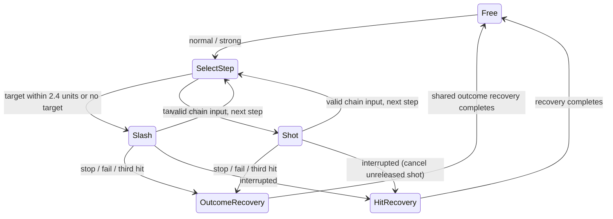

# All-weapon adaptation: checkpoint and test handoff

Status: adapting one gender–weapon pair at a time. The approved HUmar/saber prototype remains opt-in; broader campaign behavior has not been enabled. See PR #791 for the persistent checklist and the current **Resume here** record.

## Spec pages

- `/states/weapon-animation-mappings/`: all 16 weapon families plus unarmed, both genders; exact PSO IDs, inspected GLB clip inventory/hashes, source gaps and class overrides.
- `/states/weapon-state-transitions/`: UML-style locomotion, combo, reaction and context diagrams. Raw sources: `spec/src/diagrams/weapon-*.mmd`.
- `/states/weapon-adaptation-plan/`: P00–P05 shared work, A01–A17 individual adaptation plans, W01–W10 test protocol.

The pages are linked from the spec States index. Their source files are under `spec/src/pages/states/`. `spec/src/data/weapon-animation-adaptations.json` is a dated local asset audit, not a runtime profile. Refresh that audit when assets change; do not infer a missing female index from the male sequence.

## Current runnable fixture

Male — Saber is the approved reference. Female — Saber now uses HUmarl with native `pwsa` idle/attacks/dodge/defeat and female PSO saber clips 327–342. Normal walk uses the existing female general-walk bake (412). Female saber is owner-approved at `cd946912`. Male sword is owner-approved at `87fcf2bf`; female sword is owner-approved at `5bd1c1e3`. Male daggers are owner-approved at `e0ec8124`; female daggers and the guard flash are owner-approved at `be66d48f`. Male claw is owner-approved at `6a49ab9a`; female claw is implemented and awaits playtest. The launcher accepts `--gender male|female` and `--weapon saber|sword|daggers|claw`; both genders are supported for saber, sword and daggers; both genders are also supported for claw.

From this worktree on this Mac:

```sh
cd /Users/kion/Projects/psz-godot-pr-791
export GODOT=/Users/kion/Applications/Godot.app/Contents/MacOS/Godot
python3 scripts/tools/run_humar_saber.py
```

Variants:

```sh
python3 scripts/tools/run_humar_saber.py --gender female
python3 scripts/tools/run_humar_saber.py --gender female --check --group
python3 scripts/tools/run_humar_saber.py --group
python3 scripts/tools/run_humar_saber.py --check
python3 scripts/tools/run_humar_saber.py --check --group
python3 scripts/tools/run_humar_saber.py --check --rendered
```

Restart the wrapper to reset the encounter. Its project/user directory isolates the fixture from campaign saves. Capture the exact `git rev-parse HEAD`, Godot version, local modifications and pack SHA before testing. A moving branch name alone is not a reproducible test reference.

## Clean setup / assets still needing publication

Follow `BUILD.md` and populate assets before importing. The current local prototype additionally uses the named charge and cursor WAV files, which must be included in the next asset-pack publication. A successful local test is not proof that the published pack contains them.

```sh
bash scripts/tools/fetch_assets_dev.sh
mkdir -p assets/sfx/common
cp web/public/assets/psobb_sfx/common/common_017.wav assets/sfx/common/
cp web/public/assets/psobb_sfx/common/common_060.wav assets/sfx/common/
"$GODOT" --headless --editor --path . --import
```

The fetch script must supply `assets/player/animations/pso_humar_saber.glb`; see `docs/humar-saber-prototype.md` for rebuild provenance if absent. Keep these SEGA-derived binary assets in the asset pipeline, not the source commit. For click-free exported playback, include the raw cursor WAV used for the PCM edge fade or publish a pre-softened imported cue; the current runtime gracefully falls back to ordinary playback if the raw source is absent.

## Approved saber reference

- PSZ relaxed idle and three native attacks; general normal walk, PSO saber caution/run/ready/reactions.
- Cursor-driven caution; 500 ms retreat hold before running; no proximity-only entry.
- 250 ms vulnerable first-attack preparation, with 80 ms pose blends.
- Normal and strong share a continuation window; palette circles replace ground rings.
- Mistimed early/late press: finish swing, then 250 ms stationary exposed recovery.
- Deliberate no-input stop: movement available after swing; attacks and guard locked for 300 ms.
- Full combo: 350 ms stationary ready recovery with deterministic frontal guard.
- Small strong-charge weapon sparks; subtle contact effect and impact sound only after HP loss; stronger accepted generic flinch.
- Softened lock-cursor sample, lower cue volume and suppression of same-target dropout repeats under 350 ms.

These are saber reference values, not final balance numbers for every weapon. The accuracy bypass and guaranteed guard must become explicit reviewed policies before campaign rollout. Keep ranged accuracy, bosses, multi-hit contact budgets and technique casting separate until P03 is complete.

## Resume record template

Copy this into **Resume here** in the PR description before leaving:

| Field | Value |
|---|---|
| Tester / date | |
| Commit / dirty changes | |
| Asset-pack SHA / extra local files | |
| Godot / platform / input | |
| Profile / avatar / weapon ID | e.g. A01-M / HUmar / saber |
| Scenario | solo / group / boss / export |
| Last completed test | Wxx |
| Next exact test | Wxx plus action to perform |
| Failure / blocker | test ID, expected vs actual, reproduction |
| Evidence | screenshot/video/log path or link |

Check a profile/gender row only after W01–W10 and its family-specific acceptance checks pass. For partial completion, record individual W IDs here and leave the row unchecked. Mark blocked profiles as **BLOCKED: reason**, not as passed. When code/assets change, mark affected completed rows for retest and preserve the previous revision/result in the record.

## Merge and release gates

1. Checkpoint and publish the approved prototype source; the PR checklist must reference that exact revision.
2. Resolve source/gender/role inventory and ship a selectable inspection fixture.
3. Extract the shared controller/profile API without changing the saber reference.
4. Implement and validate each enabled weapon/gender profile using its real hit/release schedule.
5. Publish matching animation/audio assets; validate a clean checkout and exported build.
6. Run campaign, status, boss, equipment-swap and input regressions. Original PR broad-regression failures remain open until independently resolved or classified.
7. Enable only reviewed profiles. Keep an explicit rollout/rollback gate; do not remove the prototype restriction as a shortcut to “all weapons supported.”

## Female saber asset provenance

Rebuild with `cd web && node scripts/bake-retarget.mjs --female-saber`, then import with Godot. The recipe targets `pc_010_000.glb` and selects only `pso_f_sa_*` from `data/retarget/Humar_body.glb`, producing `assets/player/animations/pso_female_saber.glb`. This local binary still needs asset-pack publication. The female profile fails visibly if its imported library is absent; it does not substitute the male profile.

Female saber local artifact SHA-256: `8452245239a43caa569d84dd214b6c6c9e8e209c6b20f1d464064329a1f5a54e`. Focused solo, three-Booma and rendered checks passed on Godot 4.5.1; male solo regression passed. Existing exit resource-leak warnings remain. Owner approved Female — Saber at `cd946912`.

## Male — Sword playtest

Run `python3 scripts/tools/run_humar_saber.py --weapon sword` (add `--group` for four Boomas, allowing the three-target cap to be tested). Rebuild the local library with `cd web && node scripts/bake-retarget.mjs --male-sword`, then import with Godot.

| Role | Explicit source |
| --- | --- |
| Relaxed idle / attacks 1–3 | PSZ `pmsw_wait`, `pmsw_atk1/2/3` |
| Normal walk | Existing general male PSO walk 200, `pmsa_walk` |
| Caution / ready / block | PSO 112 / 117 / 118, `pso_sw_walk_ready/wait/block` |
| Run | PSO saber run 111, baked as `pso_sw_run`; shared donor per owner reference |
| Light / heavy / fall / get up | PSO 122 / 120 / 123 / 121 |
| Dodge / defeated hold | Native PSZ `pmsw_esc_f`, `pmsw_dam_d_lp` |

Sword contacts use the decoded PSZ fractions 0.3191 / 0.3261 / 0.44 of the original swing, with held recoveries 180 / 200 / 280 ms. Normal and strong share the approved 55–95% continuation window. Range, three-target cap, damage, knockback and 60-degree chain turn limits remain sword-specific. Strong contact plays the sword swing cue. The shared short contact spark/sound and flinch remain as in the approved saber reference.

Focused checks cover all eight mixed combos, recovery outcomes, cursor caution, guard/reactions, exact contact onset, once-only delivery and a four-enemy test of the three-target limit. Female saber regression passed. Owner playtest and asset publication remain pending.

Local sword library SHA-256: `28e4347ddb314de8fa44e6284ffbc6a18930ee2a4d90c345a72ba11350fd6c60`.

Male sword carry grip: PSO run, caution and ready now use fixed per-pose forearm-space corrections that point the tip upward at the calibration pose while retaining animation sway. Grip changes blend over 80 ms; native PSZ attack/reaction/idle grips remain unchanged. Headless group and rendered checks verify upward carry direction and restoration of all three native attack grips.

## Female — Sword playtest

Run `python3 scripts/tools/run_humar_saber.py --weapon sword --gender female` (HUmarl). Add `--group` for four Boomas. Bake with `cd web && node scripts/bake-retarget.mjs --female-sword`, then import with Godot.

| Role | Explicit source |
| --- | --- |
| Relaxed idle / three attacks | Native `pwsw_wait`, `pwsw_atk1/2/3` |
| Normal walk | Female general walk 412, existing `pwsa_walk` |
| Caution / ready / block | PSO 343 / 348 / 349 |
| Run | Shared female saber run 342, baked as `pso_f_sw_run` |
| Light / heavy / fall / get up | PSO 353 / 351 / 354 / 352 |
| Dodge / defeated hold | Native `pwsw_esc_f`, `pwsw_dam_d_lp` |

Previously unlabeled clips 348/349/350/353/355 were rendered and inspected as ready/block/walk/light damage/photon-blast poses before adding labels. Native attacks remain authoritative; source 350 is inventoried but normal walk retains the approved general female walk. The female body has its own calibrated carry grips rather than reusing male angles. Sword contact fractions, recovery holds, target cap and turn limits match the approved male reference. Solo rendered, four-enemy group and male-sword regression checks pass. Owner playtest and asset-pack publication remain pending.

Local female sword library SHA-256: `21c6262b40766800e8fd16b1678a621c279bdaf5abd1b2191b362d8dbf8d6251`.

## Male — Daggers playtest

Run `python3 scripts/tools/run_humar_saber.py --weapon daggers` (HUmar), with optional `--group` for three Boomas. Bake with `cd web && node scripts/bake-retarget.mjs --male-daggers`, then import with Godot. Female daggers are now available with `--gender female`.

| Role | Explicit source |
| --- | --- |
| Relaxed idle / attacks | Native `pmda_wait`, `pmda_atk1/2/3` |
| Normal walk | General male walk 200, existing `pmsa_walk` |
| Caution / ready / block | PSO 125 / 130 / 131 |
| Run | Shared male saber run 111, baked as `pso_da_run` (explicit donor; no mapped dedicated dagger run) |
| Light / heavy / fall / get up | PSO 135 / 133 / 136 / 134 |
| Dodge / defeated hold | Native `pmda_esc_f`, `pmda_dam_d_lp` |

Preserve the decoded native hit schedule from `original_attack_timing.json`: 2/1/3 contacts, at [0.1556, 0.3333] / [0.2895] / [0.2075, 0.4151, 0.5849] of the original motion. These records take precedence over the old generic 2/2/3 hit-count defaults. Recovery holds are 100/120/180 ms; the approved normal/strong continuation window remains shared. Each impact consumes one target, with a 120-degree chain turn limit. Prototype reach is tuned to 2.6, horizontal cone 38 degrees, vertical tolerance 0.9 and vertical cone 45 degrees; targeting and contact share the same configuration. Every contact of a strong swing retains 1.5× power plus strong impact feedback and extended flinch, including all three contacts of the finisher. The windup cue plays once per swing. An 80 ms per-enemy feedback throttle prevents sound/particle bursts when a slow frame catches up multiple contacts. Damage contacts are never throttled.

Focused checks verify both hand attachments, authored contact onset, no repeat contact, single-target cap, strong feedback on every impact, all mixed combos and recovery outcomes. Group and rendered solo checks pass; female sword regression passes. Owner playtest and asset publication are pending.

Local male dagger library SHA-256: `a94743d033da4ab10f893857c7e64541b0e8809e7511921fffef52e382f5b30c`.

Male dagger visual: the fixture uses the native PSZ Ein Dagger (`wdac01_1_r`) mesh, native scale and tint in both hands. The equipped `dagger` resource and all combat stats remain unchanged. The shared registry resources are not mutated.

The interactive male dagger fixture includes a left-grip adjustment panel: local X/Y/Z rotations in 180°, 90° and 5° increments, Reset, Copy angles, and Save. Enemies start frozen while adjusting; toggle to resume combat. Save persists the exact basis in the ignored local `.godot/dagger-left-grip.json`; automated checks ignore this personal override. Once accepted, promote the saved basis into the attachment defaults.

Owner-saved left dagger grip promoted into the default: basis columns `(0,0,-1)`, `(0,-1,0)`, `(1,0,0)`, retaining native scale. Reset in the live panel now returns to this calibrated default.

Dagger reach checks cover an offset target at (0.8, 0, 2.2), agreement with the lock cursor, and rejection of targets behind or at distance 4. Strong third-swing power is verified against normal with identical damage variance.

## Female — Daggers playtest

Run `python3 scripts/tools/run_humar_saber.py --weapon daggers --gender female` (HUmarl). Add `--group` for three Boomas. Bake with `cd web && node scripts/bake-retarget.mjs --female-daggers`, then import with Godot.

| Role | Explicit source |
| --- | --- |
| Relaxed idle / attacks 1–3 | Native `pwda_wait`, `pwda_atk1/2/3` |
| Normal walk | General female walk 412, existing `pwsa_walk` |
| Caution / ready / block | PSO 356 / 357 / 358 |
| Run | Shared female saber run 342, baked as `pso_f_da_run` |
| Light / heavy / fall / get up | PSO 361 / 359 / 362 / 360 |
| Photon blast inventory | PSO 363 |
| Dodge / defeated hold / casting | Native `pwda_esc_f`, `pwda_dam_d_lp`, `pwda_tec` |

The shorter female source sequence 356–363 was rendered and inspected before labeling; it is not a fixed offset of the male dagger block. Missing female PSO attacks/casting are not invented: attacks and casting explicitly use native clips. Female contacts use the approved dagger profile's 2/1/3 normalized timing schedule, holds and continuation window against the female native motion lengths. Reach, targeting, strong feedback on every contact and the PSZ Ein Dagger models retain the approved male settings. Both attachment grips use the owner-calibrated defaults.

Group, rendered solo and male-dagger regression checks passed. Owner playtest and asset-pack publication remain pending. The grip panel is available; uncheck Freeze enemies for combat. Female adjustments save separately to `.godot/dagger-female-left-grip.json`, leaving the male override untouched.

Local female dagger library SHA-256: `bfa43ab82232ff75c1a4122ddb84b01c787f614ef7990a3535af76acb707387b`.

Shared successful-block feedback: a 300 ms blue-white particle burst plus a 320 ms camera-facing cyan guard flash at chest height toward the attacker, emitted only after guard acceptance. Rear/rejected blocks emit nothing. All adapted weapon profiles share it; focused checks verify emission and cleanup.

Guard flash v2 is visible through overlapping enemy geometry at chest height. The fixture window title identifies this revision; the grip panel includes Preview block to demonstrate the effect without requiring a gameplay block. Rendered checks verify emission and cleanup.

## Male — Claw playtest

Run `python3 scripts/tools/run_humar_saber.py --weapon claw` (HUmar with native PSZ Ein Claw). Add `--group` for three Boomas. Bake with `cd web && node scripts/bake-retarget.mjs --male-claw`, then import with Godot. Female claw is available with `--gender female`.

| Role | Explicit source |
| --- | --- |
| Relaxed idle / attacks 1–3 | Native `pmcl_wait`, `pmcl_atk1/2/3` |
| Normal walk | General male walk 200, existing `pmsa_walk` |
| Caution / ready | Dedicated PSO claw 170 / 174 |
| Run / block | Explicit male saber donors 111 / 103, baked as `pso_cl_run/block` |
| Light / heavy / fall / get up | Explicit male saber donors 107 / 105 / 108 / 106 |
| Casting / photon blast inventory | Explicit male saber donors 98 / 110 |
| Dodge / defeated hold | Native `pmcl_esc_f`, `pmcl_dam_d_lp` |

The source claw block has only five dedicated clips; missing roles are explicitly named donors, not suffix fallbacks. Native attacks are authoritative. The mislabeled native `pwcl_dam_h` is not imported into the profile. Claw uses its existing right-hand-only attachment and -4 degree local-Y grip with the native Ein Claw model.

Decoded contacts are 1/1/2 at [0.2368] / [0.2632] / [0.2245, 0.6735] of the original motion, overriding the old generic 2/2/2 defaults. Holds are 100/120/180 ms. Every contact of a strong swing has strong damage/feedback. Preserve single-target cap, claw damage/knockback and 120-degree turns. Prototype reach is 2.4, horizontal cone 36 degrees, height tolerance 0.9 and vertical cone 45 degrees; targeting and damage agree. The shared guard flash remains enabled.

Group and rendered solo checks pass, including both finisher contacts, no duplicates, strong feedback per contact, practical reach/cursor agreement, and guard flash cleanup. Female-dagger group regression passes. Owner playtest and asset-pack publication remain pending.

Local male claw library SHA-256: `5ec0acf5ad0625a8a037b757fd2f3991423a938a7e2e8c17929ea19cbd51315d`.

## Female — Claw playtest

Run `python3 scripts/tools/run_humar_saber.py --weapon claw --gender female` (HUmarl with native PSZ Ein Claw). Add `--group` for three Boomas. Bake with `cd web && node scripts/bake-retarget.mjs --female-claw`, then import with Godot.

| Role | Explicit source |
| --- | --- |
| Relaxed idle / attacks 1–3 | Native `pwcl_wait`, `pwcl_atk1/2/3` |
| Normal walk | General female walk 412, existing `pwsa_walk` |
| Caution / ready | PSO female claw 381 / 385 |
| Source attack inventory (unused in combat) | PSO 382 / 383 / 384 |
| Run / block | Explicit female saber donors 342 / 333 |
| Light / heavy / fall / get up | Explicit female saber donors 338 / 336 / 339 / 337 |
| Casting / photon blast | Explicit female saber donors 328 / 341 |
| Dodge / defeated hold | Native `pwcl_esc_f`, `pwcl_dam_d_lp` |

Source clips 381–385 were rendered and inspected before labeling. Female native attacks use the approved claw 1/1/2 normalized contact schedule and holds against their own motion lengths. Reach, single-target cap, strong feedback on every contact, guard flash, and native right-hand grip retain the approved male settings. Group, rendered solo and male-claw regression checks passed. Female Claw owner-approved at `5e795966`; asset publication remains pending.

Local female claw library SHA-256: `702bebfd11ca6a29803629f7179f32ea5d2efda78263fdce93de946bf4b45f21`.

## Male — Double saber playtest

Run `python3 scripts/tools/run_humar_saber.py --weapon double-saber` (HUmar with native PSZ Ein Double Saber). Add `--group` for four Boomas. Add `--gender female` for HUmarl. Bake with `cd web && node scripts/bake-retarget.mjs --male-double-saber`, then import with Godot.

| Role | Explicit source |
| --- | --- |
| Relaxed idle / attacks 1–3 | Native `pmds_wait`, `pmds_atk1/2/3` |
| Normal walk / run | General male 200 (`pmsa_walk`) / saber 111 |
| Caution / ready | PSO double saber 165 / 169 |
| Source attacks (unused in combat) | PSO 166 / 167 / 168 |
| Casting / block | Male sword 113 / 118 |
| Light / heavy / fall / get up | Male sword 122 / 120 / 123 / 121 |
| Photon blast | Male sword 124 |
| Dodge / defeated hold | Native `pmds_esc_f`, `pmds_dam_d_lp` |

The native model attaches at its central grip in the right hand. The owner-saved orientation is local X/Y/Z = 0°/0°/0° (identity basis), promoted into the prototype default. Preserve native reach 2.6, horizontal angle 60°, vertical height 0.8, vertical angle 45°, turn limit 180° and three targets per impact. Decoded contact counts are 2/1/3 at normalized fractions [0.3404, 0.3617], [0.3953], [0.3922, 0.4706, 0.5294], with recovery holds [0.14, 0.16, 0.22] seconds. Every strong contact gets strong damage and flinch; only closely spaced audiovisual feedback is throttled.

Four-enemy checks verify three targets per impact, no duplicate contact, all strong contacts, and shared continuation timing. Rendered solo and female-claw regression checks passed. Male double saber owner-approved at `4d7f99b6`; asset publication remains pending.

Local male double saber library SHA-256: `12f680c0118eba6c67e6a481e36376636372c69f26066f3a9210bb0a568f9772`.

## Female — Double saber playtest

Run `python3 scripts/tools/run_humar_saber.py --weapon double-saber --gender female`. Add `--group` for four Boomas. Bake with `cd web && node scripts/bake-retarget.mjs --female-double-saber`, then import with Godot.

| Role | Explicit source |
| --- | --- |
| Relaxed idle / attacks | Native `pwdss_wait`, `pwdss_atk1/2/3` |
| Normal walk / run | General female 412 (`pwsa_walk`) / saber 342 |
| Caution / ready | Female double saber 376 / 380 |
| Source attacks (unused in combat) | 377 / 378 / 379 |
| Casting / block | Female sword 344 / 349 |
| Light / heavy / fall / get up | Female sword 353 / 351 / 354 / 352 |
| Photon blast | Female sword 355 |
| Dodge / defeated hold | Native `pwdss_esc_f`, `pwdss_dam_d_lp` |

Female source poses were reviewed in the rendered fixture. Native `pwds_run` is deliberately unused; attacks and idle use `pwdss`. Retains the male-approved 2/1/3 contact schedule, strong damage/flinch on every impact, three-target cap and native reach/turn geometry. The approved identity grip persists through all eight normal/strong combo combinations. Live rotation controls save female adjustments separately in `.godot/double-saber-female-grip.json`.

Four-enemy and rendered solo checks passed. Female double saber owner-approved at `b16dfa16`; asset publication remains pending. Local library SHA-256: `67d330c58f2901952cbea3afc8dd80cbbb0fa8db0cb05993cd604b07f6182533`.

## Male — Spear / partisan playtest

Run `python3 scripts/tools/run_humar_saber.py --weapon spear` (HUmar with native PSZ Ein Spear). Add `--group` for four Boomas. Use `--gender female` for the female adaptation. Bake with `cd web && node scripts/bake-retarget.mjs --male-spear`, then import with Godot.

| Role | Explicit source |
| --- | --- |
| Relaxed idle | Native `pmsp_wait` |
| Attacks | Native PSZ `pmsp_atk1/2/3`; PSO 140–142 rejected in owner playtest |
| Normal walk | General male 200 (`pmsa_walk`) |
| Caution / ready / run | PSO partisan **145** / 143 / 151 |
| Casting / block | Partisan 139 / 144 |
| Light / heavy / fall / get up | Partisan 148 / 146 / 149 / 147 |
| Photon blast | Partisan 150 |
| Dodge / defeated hold | Native `pmsp_esc_f`, `pmsp_dam_d_lp` |

Owner requested a fuller partisan adaptation after rejecting the spear-thrust version. The runtime caution alias `pso_pa_walk_ready` now uses source 145 instead of 138. Carry poses use calibrated local grips, accounting for the Ein Spear mesh shaft being 30 degrees off local +Z; caution and run point upright; ready stance 143 holds the tip diagonally upward across the torso at 45° at its calibration pose, retaining animated sway.

All three swings use native PSZ attacks, each with one impact and up to three targets. Prototype sweep geometry is reach 3.2, horizontal angle 65°, vertical height 0.9 and vertical angle 45°; native chain turns remain 75°. Contact fractions [10/34, 11/37, 22/40] follow the decoded PSZ spear hit frames. Recovery holds remain [0.14, 0.16, 0.22] seconds. Normal/strong inputs retain the shared continuation window and combo outcomes.

Checks cover per-swing three-target caps, single impacts, strong damage/flinch, shared combo timing and upright actual shaft direction. Owner playtest and asset publication remain pending.

Local male spear source library SHA-256: `2e742a0f6c2e74e774df0b82e4085cea0fb3df6493ecc06ae72298a20e8b2b34` (runtime aliases and grip corrections are in code).

### Spear grip adjustment panel

The interactive spear fixture opens with a per-animation rotation panel. Select relaxed idle, normal walk, caution 145, ready 143, run, native attacks or block. Preview freezes player movement and enemies; disable Play to hold/scrub a pose. Local XYZ controls rotate by ±5°, ±90° or 180°. Switching poses preserves unsaved adjustments. Reset selected affects only that animation; Save all writes `.godot/spear-male-grips.json`. Uncheck Preview to test the same overrides through gameplay transitions. Automated combat checks ignore this local file. The panel smoke check (`PSZ_SPEAR_CONTROLS_CHECK=1`) verifies pose switching, gameplay application and reset without writing the user's saved file.

Owner-saved normal walk (`pmsa_walk`) and relaxed idle (`pmsp_wait`) rotations are promoted separately into `PARTISAN_SAVED_GRIPS`. Local panel overrides remain available for further tuning.

Owner-saved attack grips `pmsp_atk1`, `pmsp_atk2`, and `pmsp_atk3` are also promoted independently. Combo checks verify each grip across all eight normal/strong input combinations.

## Female — Spear / partisan playtest

Male spear owner-approved at `ab2536ff`. Run female gameplay with `python3 scripts/tools/run_humar_saber.py --weapon spear --gender female --no-grip-controls`; add `--group` for four Boomas. Omit `--no-grip-controls` to adjust her grips, saved independently in `.godot/spear-female-grips.json`. Bake using `cd web && node scripts/bake-retarget.mjs --female-spear` and import with Godot.

| Role | Explicit source |
| --- | --- |
| Relaxed idle / attacks / dodge / defeated hold | Female native `pwsp_wait`, `pwsp_atk1/2/3`, `pwsp_esc_f`, `pwsp_dam_d_lp` |
| Normal walk | General female 412, `pwsa_walk` |
| Caution / ready / run | Shared male partisan donors 145 / 143 / 151, retargeted to HUmarl |
| Casting / block | Shared partisan 139 / 144 |
| Light / heavy / fall / get up / photon blast | Shared partisan 148 / 146 / 149 / 147 / 150 |
| Unused source inventory | Partisan attacks 140–142; original caution 138 replaced by 145 |

These are explicit shared donors, not claimed female source IDs. The runtime prefix is `pso_f_pa`; `source_prefix: pso_pa` records the source mapping. Female attack/idle/dodge clips remain gender-specific. Carry directions were measured on the female skeleton; her independent grip table starts with the approved male walk/idle/attack bases. Normal walk uses her female animation. Native hit timing, three-target sweep geometry and combo outcomes retain the male-approved settings.

Four-enemy and rendered checks passed, including upright caution/run, diagonal ready and 24 attack-grip transition checks. Male spear regression passed. Owner playtest and asset publication remain pending.

Female spear library SHA-256: `b334ba7a10201e2126751fde3b73206d859a8cbd4e82f7c452a8f255c6f60c1b`.

## Male — Slicer playtest

Female spear owner-approved at `d1a2cfa5`. Launch `python3 scripts/tools/run_humar_saber.py --weapon slicer --no-grip-controls`; add `--group` for five Boomas. Bake with `cd web && node scripts/bake-retarget.mjs --male-slicer`, then import with Godot. Female slicer remains disabled until adapted.

| Role | Explicit source |
| --- | --- |
| Relaxed idle / attacks / dodge / defeated hold | Native `pmsl_wait`, `pmsl_atk1/2/3`, `pmsl_esc_f`, `pmsl_dam_d_lp` |
| Normal walk / run | General male 200 (`pmsa_walk`) / explicit saber 111 |
| Caution / ready | PSO slicer 152 / 156 |
| Casting / block | Explicit saber 98 / 103 |
| Light / heavy / fall / get up / photon blast | Slicer 162 / 160 / 163 / 161 / 164 |
| Unused source inventory | Slicer attacks 153–155, walk 158, stand 159 |

Native PSZ Ein Slicer is equipped. One projectile releases per swing. Step 1 uses decoded `16_slicer_m` frame 10/33; steps 2 and 3 have no decoded release marker and use provisional fractions 0.40 / 0.45 for owner tuning. Holds remain 0.14 / 0.16 / 0.22 seconds, with the shared normal/strong continuation window.

Prototype projectile speed remains 20, total travel budget 8, bounce radius 3 and four-target maximum. The blade now travels to the nearest eligible enemy after each impact instead of immediately damaging neighbors. It stops when there is no eligible next target or its hit/range budget is exhausted. Existing campaign projectile behavior is unchanged; no returning blade is added. Strong feedback is snapshotted into the projectile and occurs at impact. Release does not cause melee damage.

Focused checks cover one release per swing, no early/duplicate release, impact-only damage, four-target cap against five enemies, no repeated damage to one enemy, strong impact flinch and interrupted-swing cancellation. Owner playtest and asset publication remain pending.

Local male slicer library SHA-256: `f70cbd88cc34b9410dc4df586305afe8ef2ae3bd9b26520c3e7e5a6ebca7ede0`.

### Slicer grip and projectile follow-up

The interactive slicer fixture now offers the per-animation grip panel; saves go to `.godot/slicer-male-grips.json`. Use `--group` to test against five enemies, then uncheck Preview to resume combat. Gameplay feel was accepted, but male slicer remains unchecked until grip/projectile review is complete.

The published [weapon storybook](https://kion-dgl.github.io/psz-godot/tools/storybook/weapons/) lists these alternate variants:

| Family | Listed variants |
| --- | --- |
| wslc01 / wslc02 / wsln01 | `_1_o`, `_3_o` |
| wslr01 / wslr02 / wslr03 | `_1_o`, `_2_o` |
| wslr04 / wslr05 | `_1_o` only |

The prototype equips Ein Slicer (`wslc01_1_o`) and uses the alternate `wslc01_3_o` mesh as its spinning thrown blade. Other families are inventoried, not yet wired or verified as projectile models. Fetch the ignored GLB and PNG with `sh scripts/tools/fetch_slicer_projectile.sh`, then import with Godot. GLB SHA-256: `ddbfb0b411174de47b23e2e0a6c3206a178b6def106cf900f1d809c4ff3743dc`; PNG: `33cb37ed51c858759db4d39bed0bf8b0ed11f52f341a407376ebae921ecdb4c8`.

The new prototype-only `slicer_projectile.gd` follows physical travel between targets, retains released strong-hit state, excludes already-hit/dead/hidden enemies, and respects the total range budget. Five-enemy checks simulate the projectile sweep between impacts and reject instant area damage and fifth-target hits.

The owner-saved slicer relaxed-idle grip is now the common fixture grip for all slicer animations, including spawn, movement, ready, attacks and reactions. The attachment and attack/idle transition paths preserve it. Per-pose panel overrides remain available for future exceptions.

## Female — Slicer playtest

Male slicer owner-approved at `419f0c80`. Launch `python3 scripts/tools/run_humar_saber.py --weapon slicer --gender female --group --no-grip-controls` for five-enemy gameplay. Omit `--no-grip-controls` for adjustment controls; female saves are isolated in `.godot/slicer-female-grips.json`. Bake via `cd web && node scripts/bake-retarget.mjs --female-slicer`, then import with Godot.

| Role | Explicit source |
| --- | --- |
| Relaxed idle / attacks / dodge / defeated hold | Female native `pwsls_wait`, `pwsls_atk1/2/3`, `pwsls_esc_f`, `pwsls_dam_d_lp` |
| Normal walk / run | General female 412 (`pwsa_walk`) / female saber 342 |
| Casting / block | Female saber 328 / 333 |
| Caution / ready | Shared male slicer 152 / 156, retargeted to HUmarl |
| Light / heavy / fall / get up / photon blast | Shared slicer 162 / 160 / 163 / 161 / 164 |

Shared slicer donor IDs are explicit, not claimed female source discoveries. The runtime prefix is `pso_f_sl`, with `source_prefix: pso_sl` for the audited mapping. Native female source data also provides only the first release marker (10/33); attacks 2/3 retain the approved provisional 0.40/0.45 timings.

The approved common hand grip applies to every female pose and combo. Traveling blade, four-target maximum, impact-only damage, strong feedback and interrupted-release cancellation are shared with the approved male behavior. Five-enemy checks and male regression passed; rendered ready/attack poses reviewed. Owner playtest and asset publication remain pending.

Female slicer library SHA-256: `f3ba1d06c998e51ad2e2db21580adcb2e891d46faa27ba35675cde0c09a0b05b`.

## Male — Gunblade playtest

Female slicer owner-approved at `47d40ef0`. Run `python3 scripts/tools/run_humar_saber.py --weapon gunblade --no-grip-controls`; add `--group` for three Boomas. Each combo step independently selects a slash for a targeted enemy within 2.4 horizontal units, or a shot for a farther target. Without a target it slashes. Selection commits before the step windup (including first-hit preparation); movement during that windup does not change the action. All eight slash/shot sequences share the normal/strong timing window. There is no mode-toggle input. Target acquisition spans 8 units with a 40° cone regardless of the previous action. The owner-saved identity grip applies to all blade and gun poses. Female gunblade is now available for owner testing.

Bake with `cd web && node scripts/bake-retarget.mjs --male-gunblade`, then import Godot. This fixture equips **Axeon** (weapon type 7) and explicitly resolves its native `wgbr02_1_o` visual from its legacy model metadata. Ein Mazurka is currently classified as rifle (11) in item data and was not used; its registry entry is unchanged.

| Role | Explicit source |
| --- | --- |
| Blade idle / attacks / dodge / defeated hold | Native `pmgb_wait`, `pmgb_atk1/2/3`, `pmgb_esc_f`, `pmgb_dam_d_lp` |
| Blade caution / ready / run | Male saber 97 / 102 / 111, aliased `pso_gb_*` |
| Normal walk | General male 200 (`pmsa_walk`) |
| Casting / block | Male saber 98 / 103 |
| Heavy / get up / light / fall / photon blast | Male saber 105 / 106 / 107 / 108 / 110 |
| Gun idle / firing | Native `pmgb_wait_sht` / `pmgb_sht` (three `pmgb_shot_atk*` aliases) |
| Gun caution / ready / run | Male rifle 10 / 13 / 22, aliased `pso_gb_gun_*` |

Melee contact fractions follow native decoded frames 9/36, 11/39 and 16/43. Gun mode uses one projectile per step and a provisional 0.35 release fraction; it is an experimental three-step shooting mode, not a claim of exact original PSZ gunblade spread behavior. Both modes use holds [0.14, 0.16, 0.22] seconds and the approved shared input window. Blade reach is 2.4 with a 40° horizontal cone; gun reach is 8 with a 15° cone. Both hit one target per impact. Damage uses the existing gunblade item/fallback combat calculation. Strong state is retained in the released projectile.



Male gunblade owner-approved at `762e6e5e`, including the common grip and automatic mixed combos. Focused checks passed all eight slash/shot sequences with all eight normal/strong combinations, projectile/contact separation, interruption and shared recovery. Female gunblade is next; asset publication remains pending.

Local gunblade library SHA-256: `46f6e2dc7c58b50a6763932b878c9085b7cc96974665a4aab943779cc7b051ae`.


## Female — Gunblade playtest

Run `python3 scripts/tools/run_humar_saber.py --weapon gunblade --gender female --no-grip-controls`. Bake with `--female-gunblade`. Female saber donors (16 clips) provide blade stances; female rifle 250/253/262 provide gun caution/ready/run. The female shotgun library supplies native `pwgbs` melee, dodge and defeat, plus its mixed-prefix `pmgb_sht` and `pmgb_wait_sht` shooting clips aliased under `pwgbs`. Automatic per-step range selection, common identity grip, shared timing and feedback match the approved male implementation. Female melee contact fractions currently inherit the male calibration and need owner playtesting. Female owner approval recorded below.

Female headless fixture checks passed, including all 64 mixed action/strength combinations and the gender-specific animation inventory. Library SHA-256: `23e032fde3924f5a22ef8f905a10b55d4b52fb5c4814e47435a65f4450edad0e`.

Female gunblade owner-approved at `1295a9c9`. Follow-up: hidden/dormant enemies are excluded from player cone targeting. Gunblade always uses blade idle, walk, run, preparation and recovery stances; only the shooting attack uses the gun animation. Per-step range selection remains unchanged.


## Shields deferred; Male — Handgun playtest

Both shield weapon adaptations are skipped by owner decision. Shields cannot be bought from weapon shops or equipped as weapons, including debug equip bypass. Existing shield inventory is retained, and legacy equipped shields are cleared when activating a character. A future visual armor/barrier role is undecided and is not implemented.

Run `python3 scripts/tools/run_humar_saber.py --weapon handgun --no-grip-controls`. Bake with `--male-handgun`. Native `pmhg` supplies idle, all three shots, dodge and defeat. PSO handgun sources 0–4 and 7–9 supply caution, casting, attack reference, ready, block, heavy reaction, get-up and PB; explicit saber donors 107/108/111 supply light reaction, fall and run. Normal walk remains PSZ. Native release fractions are provisionally 0.35/0.35/0.40 from the existing handgun configuration, with recovery holds 0.14/0.16/0.22. Existing handgun model grip, 9-unit range, single-target projectile and item stats are retained. Shared combo timing, strong feedback and recovery apply.

Headless checks passed all eight normal/strong shooting combinations, release/impact separation, interruption, shared movement/recovery and shield retirement checks. Owner male handgun approval remains pending. Library SHA-256: `57bbdcee4631f211c6722f1047389c5ee317c0c7caf48f7461b22242cba2a942`.

Male handgun gameplay owner-approved at `3e791949`. Follow-up photon visual fix: basic handgun variants tint and emit from photon surface 1, preserve the textured casing, and omit the wrist-mounted green light. Female handgun is next after visual confirmation.

Handgun photon follow-up: use opaque/mix emission on the untextured photon insert so additive blending cannot wash its tier color white. Handgun/Autogun/Lockgun/Railgun colors are green/blue/yellow/red. Simple-melee obstacle detours now turn the body into the movement direction, fixing the target-facing sideways slide observed on Booma. Focused material, detour direction and handgun combat checks passed.


## Female — Handgun playtest

Male handgun and photon/movement follow-ups owner-approved at `f0768f6f`. Run `python3 scripts/tools/run_humar_saber.py --weapon handgun --gender female --no-grip-controls`. Bake `--female-handgun`: female handgun PSO sources 239–249 supply the 11 stance/reaction clips, plus female saber run 342. Native `pwhg` supplies relaxed idle, all three shots, dodge and defeat; normal walk is `pwsa_walk`. Shared handgun timing, geometry, grip, photon insert and sound remain unchanged. Female owner approval pending. Library SHA-256: `0d2a21570a4e92be4606a4ccf47e34c5091550ba9b2a2877fb466123f45efbbe`.


## Male — Mechgun playtest

Female handgun owner-approved at `a4994ba7`. Run `python3 scripts/tools/run_humar_saber.py --weapon mechgun --no-grip-controls`. Bake `--male-mechgun`: 11 PSO mechgun clips (23–29,32–35), with explicit saber heavy-hit/get-up donors 105/106. Native `pmmg` supplies relaxed idle, three attacks, dodge and defeat; normal walk is `pmsa_walk`. Both models retain the existing mechgun grip. Two projectile releases per step use decoded native timing [8/45,14/45], [8/46,14/46], [8/46,14/46]; releases alternate hands and play a shot sound each time. Shared combo acceptance and holds [0.14,0.16,0.22] apply. This replaces the older simultaneous 3/3/4-shot configuration within the fixture only; base item damage and range remain unchanged and balance is provisional. Owner approval pending. Library SHA-256: `432f49a25f3da3ef77a977d6ab08193a1b91563c93d7436a4dffc62f9be38900`.

Male mechgun gameplay owner-approved at `be7fed29`. Photon follow-up applies the approved handgun treatment to both mechgun models: untextured surface 1 emits the item tint with solid blending, casing stays textured, and both wrist lights are removed. Focused material and combat checks passed; visual confirmation pending.


## Female — Mechgun playtest

Male mechgun fully owner-approved at `318ff34f`. Run `python3 scripts/tools/run_humar_saber.py --weapon mechgun --gender female --no-grip-controls`. Bake `--female-mechgun`: PSO female mechgun 263–272 supplies 10 stance/reaction clips; female saber casting/PB donors 328/341 fill missing roles. The female native machinegun GLB retains `pmmg` names for its attacks and dodge; these are explicitly aliased under `pwmgs`, while relaxed idle and defeat use its native female clips. Normal walk is `pwsa_walk`. Both photon inserts, grip, alternating shots and shared combo timing retain approved male behavior. Female owner approval pending. Library SHA-256: `16ad41b77c8eea354d56ee56a0b6b77f3b56e8a3864124c42bb92896a2fbd4e2`.


## Male — Rifle playtest

Female mechgun owner-approved at `ee300294`. Run `python3 scripts/tools/run_humar_saber.py --weapon rifle --no-grip-controls`. Bake `--male-rifle`: PSO rifle 10–22 supplies 13 stance/reaction clips; saber PB 110 fills the missing role. Native `pmar` provides relaxed idle, three attacks, dodge and defeat; normal walk is `pmsa_walk`. Release fractions 0.2105/0.2308/0.3095 follow decoded native firing frames 8/38, 9/39, 13/42. Shared combo timing and recovery holds apply. Existing rifle range (12), single-target projectile, grip and item stats are retained. White photon surface 1 receives opaque tier color and emission; wrist light omitted. Male owner approval pending. Library SHA-256: `9ba6fb9c4368a8d03af3217c0efa04d7613d682f5d99fdbf6373ece485d62c1a`.

Male rifle grip calibration: owner-saved attack 1/2/3 rotations are now branch defaults. Normal walk switches to owner-requested PSO rifle 15 (`pso_ri_walk`); the grip panel opens on that pose for further alignment. The save file contained rotation entries only, with no position overrides.

Male rifle owner-approved, including all three attack grips and PSO 15 normal-walk grip. The saved walking rotation is promoted to the profile defaults alongside the existing attack rotations. No local grip file or adjustment panel is required. Female rifle is next.


## Female — Rifle playtest

Run `python3 scripts/tools/run_humar_saber.py --weapon rifle --gender female --no-grip-controls`. Bake `--female-rifle`: female PSO rifle 250–262 supplies all 13 stance/reaction clips. Normal walk uses 255, the female counterpart to owner-selected male walk 15. Native `pwars` supplies relaxed idle, three shots, dodge and defeat. Male-approved walking and attack grips are mapped onto the corresponding female clips as starting defaults, with no legacy attack-position offset; independent female grip controls remain available. Shared timing, projectile geometry and photon material are retained. Female owner approval pending. Library SHA-256: `14ed480b0af751ede4f025e5886408a3d8d7d00938ac3c784d588f03c93e24ba`.


## Male — Bazooka experimental playtest

Female rifle owner-approved at `a527f95e`. Run `python3 scripts/tools/run_humar_saber.py --weapon bazooka --group --no-grip-controls`. Bake `--male-bazooka`: PSO launcher 49–61 supplies 13 stance/reaction clips; saber fall 108 fills the missing role. Equip native Ein Bazooka. No native grenade/bazooka animation GLB exists in the current asset inventory. This explicit fallback borrows PSZ rifle `pmar` idle/fire/dodge/defeat clips; it does not claim native bazooka animation fidelity. Only the first firing clip is reachable. Native grenade decode has one firing event and no chain window, so the fixture uses one shot followed by shared ready recovery, not the old two-step or an invented three-step combo. Release follows the donor rifle motion (0.2105), with a provisional 0.22-second recovery hold and rifle sound donor.

A fixture-only shell explodes once on a valid hurtbox impact, damaging at most five living, visible, non-dormant targets within 2.5 units and with clear world geometry between impact and target. It preserves strong/element attack packets, uses ordinary hurtbox immunity handling, and shows an orange impact burst. Existing base-game projectile behavior is unchanged. Wall/range-end detonation and dedicated bazooka sounds are not implemented in this first test. Native animation import and final balance remain follow-ups; owner acceptance of this explicit donor approach is pending. Library SHA-256: `bf62294d9cb8537623804bc1fbdb2412b1340d09be2f8b600e2ed3d99b5b2b0f`.

Bazooka calibration: owner-saved PSO 52 carry/ready rotation and position promoted to branch defaults. Continue one pose at a time; next is PSO 54 normal walk.

Bazooka PSO 54 normal-walk rotation and position saved as defaults. Carry/ready remains preserved. Next calibration: caution walk, PSO 49.

Bazooka PSO 49 caution-walk rotation and position saved as defaults, preserving carry and normal walk. Next calibration: run, PSO 61.

Bazooka PSO 61 run rotation saved as a default; its position remains unchanged. Carry, normal walk and caution walk calibrations are preserved. Next calibration: launcher firing preview, PSO 51.

Bazooka PSO 51 launcher-firing rotation saved as a default; no firing position override was saved. Earlier carry/walk/run calibrations are preserved. Next calibration: block, PSO 53. Launcher firing remains a preview until the planned repeated-shot combo is implemented.

Bazooka PSO 53 block rotation saved as a default, preserving earlier calibrations. Next calibration: light damage, PSO 58.

Bazooka PSO 58 light-damage rotation saved as a default, preserving earlier calibrations. Next calibration: big damage, PSO 56.
